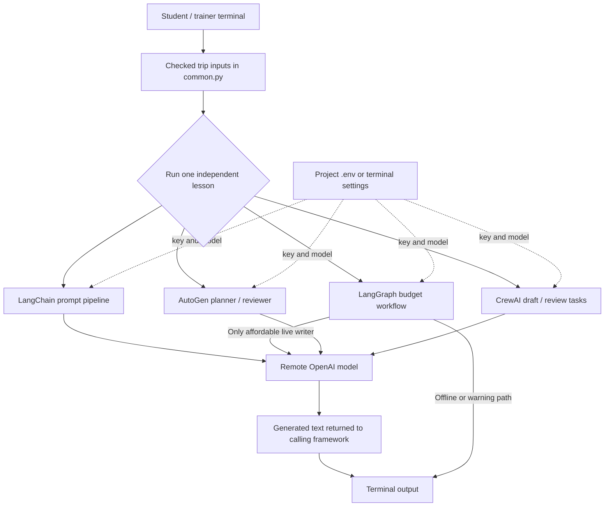
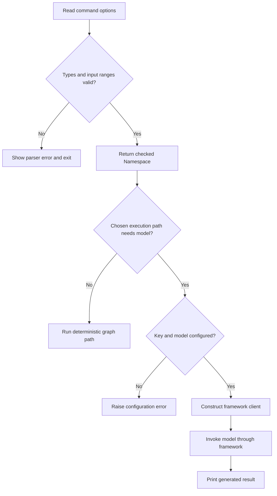
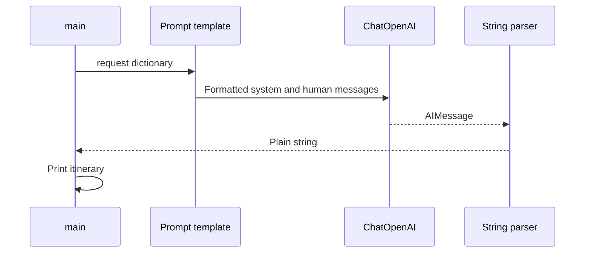
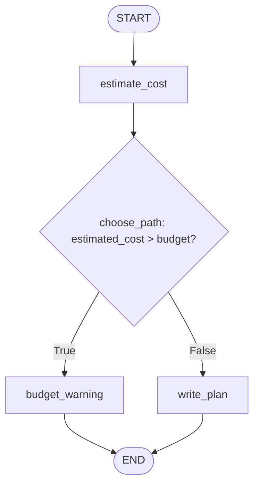
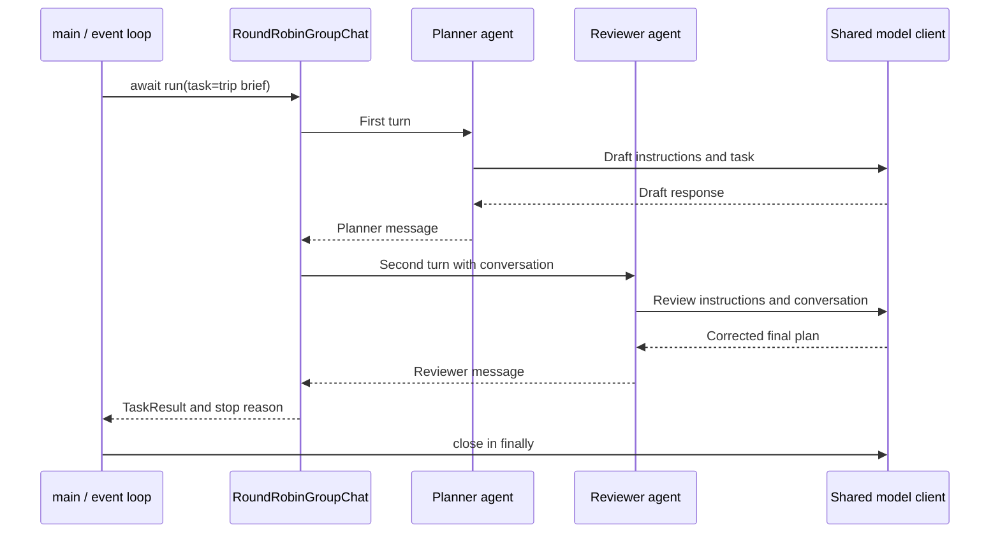
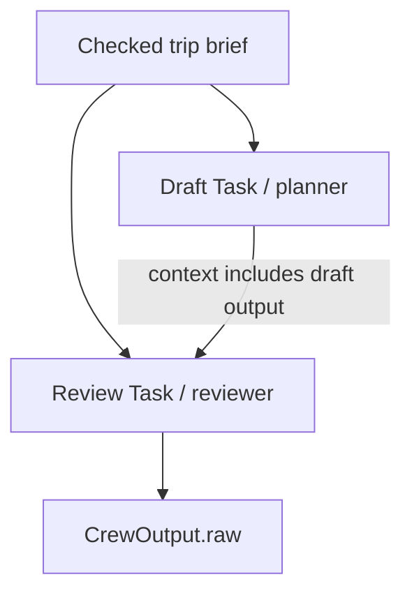

# Design document: Session 18 travel-planner project

## Problem statement

Absolute beginners need to see what LangChain, LangGraph, AutoGen and CrewAI actually do in runnable Python. The previous project combined a large travel notebook with production-style retry, guard, simulated service and revision logic. That made framework concepts hard to distinguish from ordinary application code and did not cover two of the requested frameworks.

Build a small terminal project that accepts one traveller's destination, trip length and local INR budget and returns a suggested itinerary or a clear budget warning. Demonstrate the same business problem through four separate framework designs, in a three-hour introductory session.

## Scope and success criteria

The student can run `.py` files directly, change simple inputs, identify framework objects and follow the information passed between steps. All four frameworks must be genuinely invoked in their respective demos. The active teaching code should fit in five small files, including one shared helper, with comments and docstrings explaining each statement or logical call.

Functional requirements:

| ID | Requirement | Implementation |
|---|---|---|
| F1 | Accept destination, days, total INR budget | `common.read_trip` |
| F2 | Reject empty city, days outside 1?7, nonpositive/noninteger budget | argparse and explicit checks |
| F3 | Generate a short itinerary through a prompt pipeline | Lesson 1 |
| F4 | Show state, deterministic cost and a budget decision | Lesson 2 |
| F5 | Demonstrate planner/reviewer conversation | Lesson 3 |
| F6 | Demonstrate owned tasks and output handover | Lesson 4 |
| F7 | Teach graph flow without an API | Lesson 2 `--offline` |
| F8 | Supply environment, reproducible dependencies and teaching guides | `.venv`, requirement files, README and guides |

Nonfunctional requirements: simple terminal operation, readable English explanations, input checks before paid requests, no printed credentials, visible graph node order, bounded conversation turns, and tests independent of model access. Live calls require network connectivity and an account with API credit. One failed live call must be reported honestly; it must not become a fake success response.

Out of scope: transport booking, real-time prices/weather, date handling, live search, RAG, persistent memory, vector databases, GUI, deployment, authentication for end users, production reliability and multiuser concurrency. Framework dependencies may install unrelated packages, but this application does not use those features.

## High-level design (HLD)

The common layer owns input and settings only. Each lesson owns its own orchestration. The scripts share no saved state and do not depend on earlier runs. One provider/model is used across all frameworks to reduce setup work. All model prompts label costs as estimates. Only the graph makes a deterministic affordability decision; the others request model-written budget notes.

The environment is local to `session18_practical_kit/.venv`. CrewAI internal bookkeeping is directed into the ignored project-local `.crewai` directory; it is not used as conversational memory. `.env` is local and ignored by Git. The example settings file contains a placeholder. Original files are in `legacy_archive` for preservation and are excluded from the teaching path.

## Low-level design (LLD): inputs and settings

| Field | Type | Default | Rules / meaning |
|---|---|---|---|
| destination | string | Goa | Trim whitespace, 1?80 characters |
| days | integer | 3 | Inclusive range 1?7 |
| budget | integer | 15000 | Positive, total INR for one person's local costs |
| offline | Boolean | false | Available only in lesson 2 |
| OPENAI_API_KEY | secret string | none | Required when a model client is used |
| OPENAI_MODEL | string | gpt-4o-mini | Nonempty, compatible OpenAI model |

The budget includes local stay, food and activities and excludes travel to/from the destination. No number of hotel nights is inferred. The sample daily estimate intentionally avoids pretending to be a real travel-price model.

`read_trip` returns an argparse Namespace. `trip_brief` turns it into task text. `model_settings` returns a two-item tuple. `.env` is resolved using the helper file location. Existing terminal settings have priority, allowing a trainer to override settings for one shell without editing source.

## LLD: LangChain pipeline

`build_chain()` creates a ChatPromptTemplate with system/human messages, a ChatOpenAI client and StrOutputParser. The returned runnable takes `{"request": string}` and returns text. `main()` obtains checked input, builds the brief and invokes it.

There are no tools or agents in this lesson. A pipeline is sufficient for one prompt-to-answer transformation. The string parser does not validate factual accuracy or cost arithmetic.

## LLD: LangGraph workflow

TripState schema:

| Key | Producer | Consumer |
|---|---|---|
| destination, days, budget, offline | `main` | Cost/writer/router nodes as needed |
| estimated_cost | `estimate_cost` | Router and final nodes |
| final_plan | `write_plan` or `budget_warning` | `main` |

Nodes return partial dictionaries; LangGraph merges them into the shared state. TypedDict is descriptive typing, while argparse handles runtime input validation.

Estimate formula: `estimated_cost = days * 2500`. The route uses a strict greater-than comparison. A three-day request therefore warns below INR 7500 and writes at INR 7500 or above. No loop or retry policy is taught here.

`write_plan` branches internally on `offline`: a for loop generates fixed day lines, or a ChatOpenAI call drafts text. This internal branch is ordinary Python inside a node, not an additional registered graph node. `build_graph` registers three nodes and wires the conditional paths. `compile` prepares execution. `invoke` runs it and returns a dictionary containing the final plan.

The live writer's content is not re-parsed or budget-validated. The graph guarantees which path executes under the sample rule; it does not guarantee that AI-written expenses match that rule.

## LLD: AutoGen team

`run_team(trip)` creates an OpenAIChatCompletionClient, two AssistantAgent instances, and a RoundRobinGroupChat. The planner receives the trip, the reviewer receives the ongoing conversation, and the team stops after two total turns.

`main` bridges synchronous CLI execution to async execution with `asyncio.run`. It prints selected sources from TaskResult.messages and the stop reason. There is no user-proxy, code executor or autonomous browsing tool.

## LLD: CrewAI tasks

`build_crew(trip)` constructs one LLM configuration, two agents, two tasks and one sequential Crew. Each agent has a role, goal and short backstory. Delegation, memory, cache and tracing are disabled. Each agent has `max_iter=2` to keep the example small.

The review receives explicit draft context plus the original brief, so it can compare draft and request. Task expected_output specifies desired form; it does not enforce a JSON schema. `Process.sequential` orders the tasks. `kickoff` begins execution; the final review text is returned as `CrewOutput.raw`.

Two tasks do not impose an absolute two-request ceiling: the framework can retry or iterate internally. The demo has no delegation or tools, making its intended two-step behavior clear.

## Function interfaces

| Function | Input | Output / side effect |
|---|---|---|
| `common.read_trip` | Optional allow_offline Boolean | Checked Namespace or parser exit |
| `common.model_settings` | Environment | Key/model tuple or ValueError |
| `common.trip_brief` | Namespace | Task string |
| Lesson 1 `build_chain` | Settings | Runnable pipeline |
| Lesson 1 `main` | CLI | Generated answer printed |
| Lesson 2 `estimate_cost` | State | Estimate update |
| Lesson 2 `choose_path` | State | Destination node name |
| Lesson 2 `budget_warning` | State | Warning output update |
| Lesson 2 `write_plan` | State | Fixed or generated plan update |
| Lesson 2 `build_graph` | None | Compiled graph |
| Lesson 2 `main` | CLI | Execute and print graph result |
| Lesson 3 `run_team` | Namespace | Async TaskResult; client closed |
| Lesson 3 `main` | CLI | Conversation and stop reason printed |
| Lesson 4 `build_crew` | Namespace | Configured Crew |
| Lesson 4 `main` | CLI | Execute crew and print final text |

## Error behavior and practical limits

Input errors exit with a parser message before paid requests. Missing settings raise a clear ValueError at client setup. Authentication, quota, network and model errors surface to the trainer as exceptions; the lesson does not swallow them or replace them with fake AI output. LangChain/AutoGen clients use a 45-second request timeout and one retry. Framework behavior can make total elapsed time longer. CrewAI has a 45-second model timeout and its own iteration/retry behavior.

Only checked trip text and instructions are sent to the model. Keys remain local and are used for authentication. `.env.example` is safe to distribute; `.env`, `.venv` and the legacy archive should be excluded from the classroom handout. Optional telemetry is disabled by default; users can override shell settings.

## Validation and acceptance

Deterministic tests exercise the real compiled graph with offline data: affordable, under-budget and exact-boundary cases; minimum/maximum day count; and invalid CLI inputs. Missing-key behavior is checked without remote requests. Framework imports/construction are checked in the installed environment. Live executions are recorded separately because offline checks cannot establish API validity or generated-content quality. See `VALIDATION.md` for actual results.

Accept the teaching package when all four scripts are present, the environment resolves, deterministic tests pass, both graph routes are demonstrated, and any live execution limitation is clearly documented before class. A trainer should rehearse every live script using their own funded account before presenting it.

## Design choices and later extensions

One small shared helper avoids repeated setup. Separate scripts make framework differences visible. Explicit CLI inputs replace complicated natural-language parsing. A single budget branch is easier to trace than a revision loop. All diagrams are Mermaid text so the trainer can edit them without an image service; a Markdown viewer with Mermaid support renders them.

Later lessons may add structured output validation, cost arithmetic, real data tools, bounded retries, persistence or human approval. Those require additional design and tests and are intentionally outside this first three-hour project.
