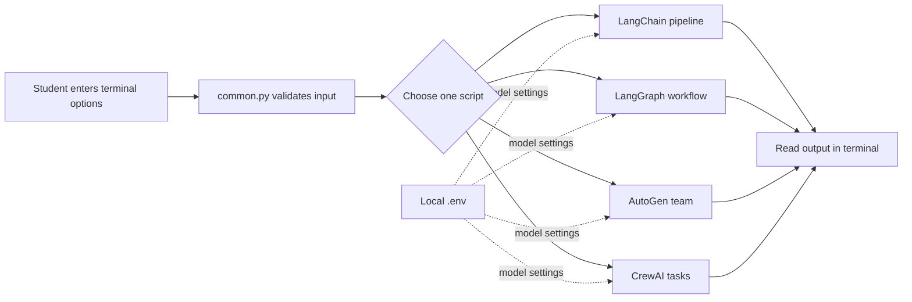
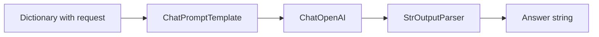
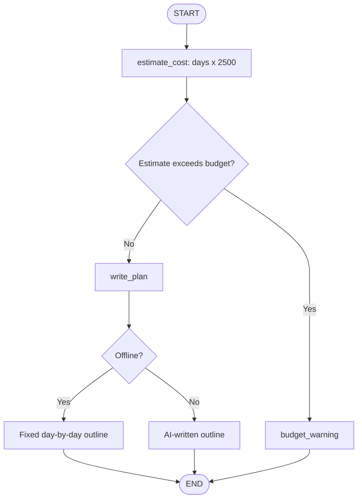
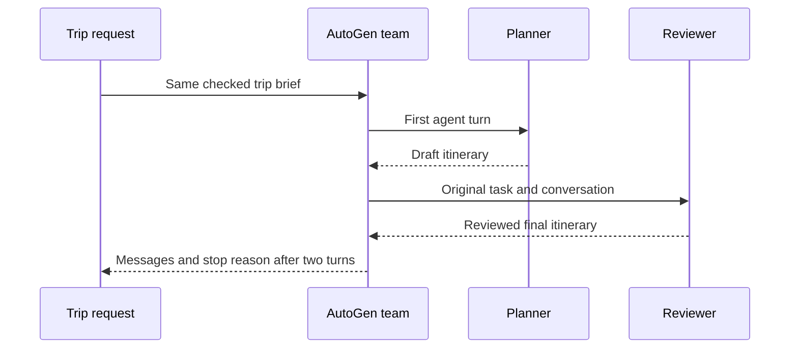
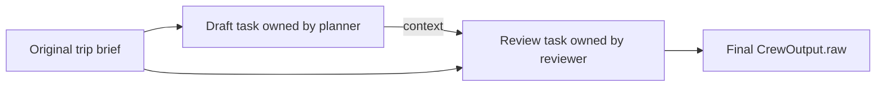

# Student guide: build a simple travel planner four ways

## 1. What we are doing

A traveller gives us a city, number of days and total local budget in Indian rupees. Our program suggests what to do each day. We will express this same problem using four Python frameworks. We are comparing how the work is arranged, so each script runs independently. Nothing must be copied between their outputs.

For example, Goa, three days and INR 15,000 is one request. We assume one person and include stay, food and local activities. We exclude travel to/from Goa. We do not search live prices, reserve a room, check weather or sell a tour. Every cost is an estimate for practice.

Our learning goals are to read a short Python script, run it with inputs, follow data between functions, and explain where each framework helps.

## 2. Words to understand first

| Word | Plain-English meaning here |
|---|---|
| Python script | A `.py` text file containing instructions Python can execute |
| Import | Bring a named object from another Python module into this file |
| Function | A named group of instructions that can receive inputs and return a result |
| Argument | A value supplied to a function or command |
| Variable | A name that refers to a value |
| String | Text, usually written inside quotes |
| Integer | A whole number such as 3 or 15000 |
| List | Ordered values inside square brackets, such as two agents |
| Dictionary | Named values inside braces, such as `{"days": 3}` |
| Class/object | A class describes a kind of object; calling it creates an instance |
| Model / LLM | A language model service that produces text from instructions |
| Prompt | The text and messages sent to the model |
| Framework | A library that supplies reusable building blocks and execution rules |
| Agent | In this lesson, a model configured with a role and instructions |
| State | Information passed between graph steps |
| Node / edge | A graph step / a connection deciding where execution goes next |
| Virtual environment | This project's own Python packages, separate from other projects |
| API key | A secret credential used to access a remote service |

A model writes content. A framework arranges calls and moves data. An agent is not a new trained model: our planner and reviewer share the same model with different instructions.

## 3. High-level design



Read this left to right. Every script checks the same inputs. You choose one way to arrange the work. Most paths call a remote model. LangGraph's offline mode and budget-warning branch do not. Output goes to the terminal and is not saved to a database.

## 4. Get ready and run

Use the README setup steps first. From this project's folder, run:

```powershell
.\.venv\Scripts\python.exe 02_langgraph_workflow.py --destination Goa --days 3 --budget 15000 --offline
```

The first part selects the project's Python. The next part names the file. Each `--name value` pair supplies an input. `--offline` is a switch with no following value. You should see the estimate node, writer node, a sample cost of 7500 and three day lines.

All scripts accept `--destination`, `--days`, `--budget`. Defaults are Goa, 3 and 15000. Days must be 1?7 and budget must be a positive integer. Put multiword cities in quotes: `--destination "New Delhi"`. Only lesson 2 accepts `--offline`. The other three scripts require your own configured API key and credit.

To see available inputs, add `--help` to a script. To stop a running command, press Ctrl+C. Do not keep retrying paid runs merely to obtain identical wording.

## 5. How to read the Python comments

The opening triple-quoted text is the module docstring: it explains the file and gives a run example. Each function has its own docstring describing purpose, inputs or output. Text after `#` is a comment; Python ignores it. Read it alongside the statement it explains.

Indentation groups statements. A colon starts a block such as a function, `if`, `for` or `try`. `return` sends a result to the caller and ends that function call. `print` displays a value but does not return it to another step. `f"...{value}..."` inserts a value into text. A function name followed by parentheses calls the function.

In every file, `if __name__ == "__main__":` calls `main` only when you run that file directly. Importing the file for a check should not launch a paid trip request. Model clients are built inside functions rather than being run during import.

The lesson comments explain statements in order. Multiline calls are one statement: the argument lines configure the object named at the start. Parentheses let that single statement continue over several lines.

## 6. Shared helper: `common.py`

This file prevents us from repeating input handling in all four lessons. It contains no model call.

At the top, `argparse` handles terminal arguments, `os` reads environment settings and `Path` locates files. `load_dotenv` loads this project's `.env`. `Path(__file__).with_name(".env")` means ?the .env beside this Python file,? so it does not accidentally pick another lesson's settings from the current terminal folder. `override=False` preserves values already set in the terminal.

The `setdefault` statements turn off optional telemetry/tracing by default. They are setup lines, not part of the travel logic. `CREWAI_STORAGE_DIR` keeps CrewAI's internal bookkeeping files inside this project's ignored `.crewai` folder, even though our lesson does not use conversation memory. A pre-existing terminal setting can still override these defaults.

### `read_trip(allow_offline=False)`

Input: a Boolean telling it whether to offer the offline switch. Output: a Namespace, an object whose values you can access as `trip.days` or `trip.budget`.

`ArgumentParser` creates the command reader. `add_argument` declares each option, default and expected type. `type=int` converts text such as `"3"` into integer `3`, rejecting words such as `three`. With `allow_offline=True`, `action="store_true"` makes the offline value false by default and true when the switch is present.

`parse_args` reads the command. `strip` removes extra spaces around the city. The following `if` statements check city length, day range and positive budget. `parser.error` explains a problem and stops the program; no model has been called. Finally, `return trip` sends the checked values to the lesson.

Try `--days 0`: it should fail. Try `--days 7`: it is allowed. A positive budget is accepted even when insufficient; the graph's budget route handles that separate business decision.

### `model_settings()`

Input: none. Output: `(key, model)`, a tuple with two values. `os.getenv` reads each setting. A missing/placeholder key raises `ValueError` with an explanation instead of silently inventing an answer. The model defaults to `gpt-4o-mini`; an empty model value is rejected.

A caller writes `key, model = model_settings()` to unpack the tuple. The key is given to a client and never printed. This helper checks only that a setting exists; the remote service decides whether the key is valid and whether the account has credit.

### `trip_brief(trip)`

Input: checked trip options. Output: one task string. It inserts city, days and budget using f-strings and includes one-person scope, cost categories, exclusions, estimate wording and a short length request. Adjacent quoted strings inside parentheses combine into one string.

LangChain, AutoGen and CrewAI use this exact brief. LangGraph constructs a shorter writer request because its earlier node already computed the practice estimate.

## 7. Lesson 1: `01_langchain_plan.py`

This file introduces a reusable prompt pipeline. It has two functions.



### `build_chain()`

Input: none. Output: a runnable LangChain pipeline. It first reads the key and model. `ChatPromptTemplate.from_messages` creates a system instruction and a human-message template. System instructions set the model's role and estimate rules. `{request}` is a placeholder; it is not filled until invocation.

`ChatOpenAI` creates a configured client. `model` selects the language model, `api_key` supplies credentials, `temperature=0` requests lower variation, `timeout=45` sets the request timeout and `max_retries=1` permits one client retry. None of these proves the response correct. A retry may make a failed request take longer than 45 seconds overall.

`prompt | llm | StrOutputParser()` connects three components. The pipe sends the previous output into the next step. The prompt becomes chat messages, the model returns an AI message and the parser extracts its text. This pipeline is not an autonomous multi-agent system.

### `main()`

Input: terminal options via the shared helper. Output: text printed to the terminal. It reads the trip, builds the chain and calls `invoke({"request": trip_brief(trip)})`. The dictionary key matches the placeholder in the prompt. Invocation makes the model request and returns a string. `print(answer)` shows that string.

Run the Goa example in the README. Then change the city and compare the daily suggestions. Check the arithmetic yourself. The parser extracts text; it does not validate an itinerary schema or total.

## 8. Lesson 2: `02_langgraph_workflow.py`

This file demonstrates explicit control flow. A model is optional; the graph framework itself still runs in offline mode.



### `TripState`

This is a TypedDict class describing six fields. Destination, days, budget and offline are inputs. The estimate node adds `estimated_cost`; a final node adds `final_plan`. Type hints help people and tools understand the dictionary. They do not automatically enforce runtime validation. Only changed fields need to be returned by each node.

### `estimate_cost(state)`

Input: current state. Output: a dictionary containing `estimated_cost`. Multiplying days by 2500 gives a fixed sample local cost. For three days the answer is 7500, regardless of destination. The printed node name lets us observe the workflow. No API is used.

### `choose_path(state)`

Input: state after estimation. Output: either `"budget_warning"` or `"write_plan"`. It compares the sample cost with the available budget. If cost is greater, it returns warning. Otherwise it returns writer. A router returns a destination name, not a plan or state update. Equality goes to the writer.

### `budget_warning(state)`

Input: estimate and budget in state. Output: a dictionary with `final_plan` holding a warning. It explains the shortfall and suggests fewer days or more budget. It does not call AI or pretend to discover a cheaper booking.

### `write_plan(state)`

Input: state for an affordable sample trip. Output: a dictionary containing `final_plan`. Offline mode starts an empty list, loops from day 1 through the final day, appends a fixed sentence and joins the list with newline characters. `range(1, days + 1)` includes days because Python's stop value is excluded.

Live mode reads model settings, constructs a chat client and invokes it with system/human messages. The client returns a message object; `.content` contains the text in this default text-only setup. Both modes return the sample cost followed by the outline. The live writer does not verify that its prose costs match the sample rule.

### `build_graph()`

Input: none. Output: a compiled runnable graph. `StateGraph(TripState)` declares the state shape. Each `add_node` pairs a name with a function. `add_edge(START, "estimate_cost")` declares the first step. The conditional-edge mapping associates the router's returned strings with nodes. Both final nodes connect to END. There is no revision loop.

`compile` checks the graph connections and prepares execution; it does not call the model. Passing a function such as `estimate_cost` registers it. Writing `estimate_cost(...)` would call it immediately, which is not what graph registration needs.

### `main()`

It enables the offline argument, makes an initial dictionary from checked inputs, calls the compiled graph's `invoke` and prints the final field. Output fields are filled during execution, so they are absent from the initial dictionary.

With three days and budget 3000, predict the warning. With budget 7500, predict writer. With budget 15000, predict writer. Try all three offline and observe the node names.

## 9. Lesson 3: `03_autogen_team.py`

Here two model-backed agents share a conversation. AutoGen supplies the turn-taking behavior; ordinary sequential Python function calls alone would not show this concept.



### `run_team(trip)`

Input: checked trip values. Output: a TaskResult with conversation messages and stop reason. This is an async function because AutoGen model requests are asynchronous. `await` waits for the result; it does not mean two agents speak simultaneously.

The model client is created once. `AssistantAgent` gives each participant a unique name, the shared client and a different system instruction. The planner drafts. The reviewer checks missing days and budget concerns and produces a corrected final answer.

`RoundRobinGroupChat([planner, reviewer], max_turns=2)` fixes the order and allows two total agent turns. `team.run(task=...)` starts the conversation. The reviewer sees the planner's earlier message. `try/finally` closes the client even if a request fails. `await client.close()` releases connection resources.

### `main()`

It reads input and calls `asyncio.run(run_team(trip))`. This starts an event loop for the async work and returns its result to ordinary Python. A `for` loop examines messages. The source check prints only planner/reviewer messages rather than the original user task. The last print shows why the team stopped.

You should see both PLANNER and REVIEWER headings. Check whether the reviewer actually improved anything. Two roles create a review opportunity; they do not guarantee correctness. We use modern `autogen-agentchat` and `autogen-ext`, so old examples importing from `autogen` are not the API used here.

## 10. Lesson 4: `04_crewai_crew.py`

CrewAI organizes work as explicit tasks owned by agents.



### `build_crew(trip)`

Input: checked trip. Output: a configured Crew, before execution. `LLM(model=f"openai/{model}", ...)` selects the provider/model format CrewAI expects. Both agents use that LLM.

For each Agent, `role` names the job, `goal` describes success and `backstory` supplies a little working context. `allow_delegation=False` prevents unplanned delegation. `max_iter=2` limits iterations; it does not promise exactly two billable requests for the whole crew. `verbose=False` reduces internal logging.

The draft Task has a description containing the trip brief, an expected output description and the planner owner. The review Task repeats the original request for comparison, asks for corrections and belongs to the reviewer. `context=[draft]` hands the completed draft result into the review task.

`Crew` receives the agent list and task list. `Process.sequential` runs tasks in order. Memory/cache are disabled to keep the example easy to follow, and tracing is disabled. No browsing, code execution or booking tools are configured.

### `main()`

It reads options, builds the crew and calls `kickoff`. That call executes the tasks and makes model requests. Its result is CrewOutput; `result.raw` is the final task's plain text. Unlike the AutoGen print loop, this lesson prints only the final reviewed result.

## 11. Compare the choices

| Question | LangChain | LangGraph | AutoGen | CrewAI |
|---|---|---|---|---|
| What arranges work here? | A pipeline | Nodes and edges | Conversation turns | Owned tasks |
| What moves between steps? | Prompt/messages/text | Shared state updates | Conversation messages | Task context |
| What starts execution? | `chain.invoke` | `graph.invoke` | `await team.run` | `crew.kickoff` |
| How does it stop here? | Parser returns text | Chosen branch reaches END | Two agent turns | Last task completes |
| Can this demo run without a key? | No | Offline or warning path | No | No |

Choose a pipeline when you have a simple linear transformation. A graph helps when you need visible branching and state. A conversation team helps illustrate role-based dialogue. A crew makes task ownership and handover explicit. These observations describe our implementations, not every capability of each library.

## 12. Practice and check your understanding

1. Run the graph offline for Mysuru, two days, INR 10000. Expected sample cost: INR 5000, writer path, two day lines.
2. Run it for the same city/days with budget 4000. Expected: warning path and no writer.
3. Try `--days 0`. Expected: input error before graph execution or API usage.
4. Change only lesson 1's system instruction to request three bullet points. Explain why the input helper stays unchanged.
5. For one live demo, list the days and add its estimated costs yourself. Note any mismatch and discuss why text generation is not validation.
6. Trace one value, such as days=2, from terminal to Namespace to prompt or state to final output.

The test command in README runs deterministic checks without model requests. Tests help verify coded decisions such as equality at a budget boundary. They do not establish that a generated itinerary is true.

## 13. What comes later

This project deliberately omits memory, RAG, live search, retries/backoff lessons, multiuser services and deployment. First become comfortable with input, functions, dictionaries, model requests and control flow. Read [the design document](design_document.md) when you can explain the four small scripts in your own words.
